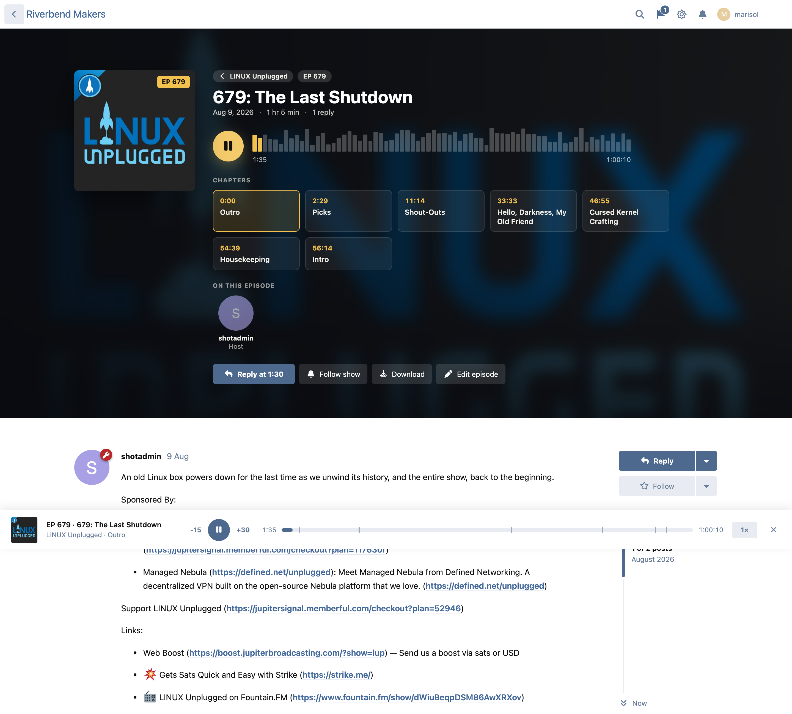
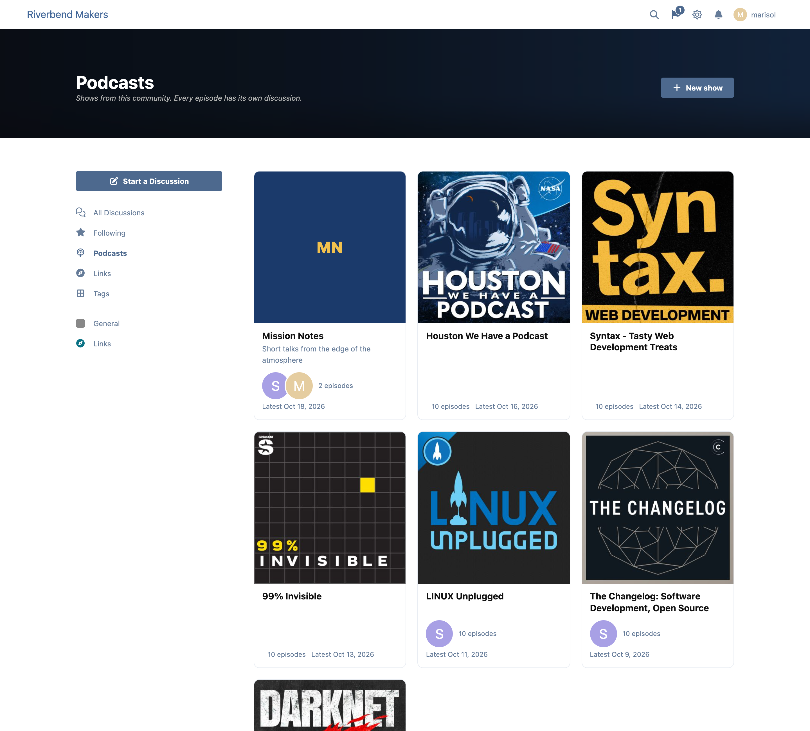
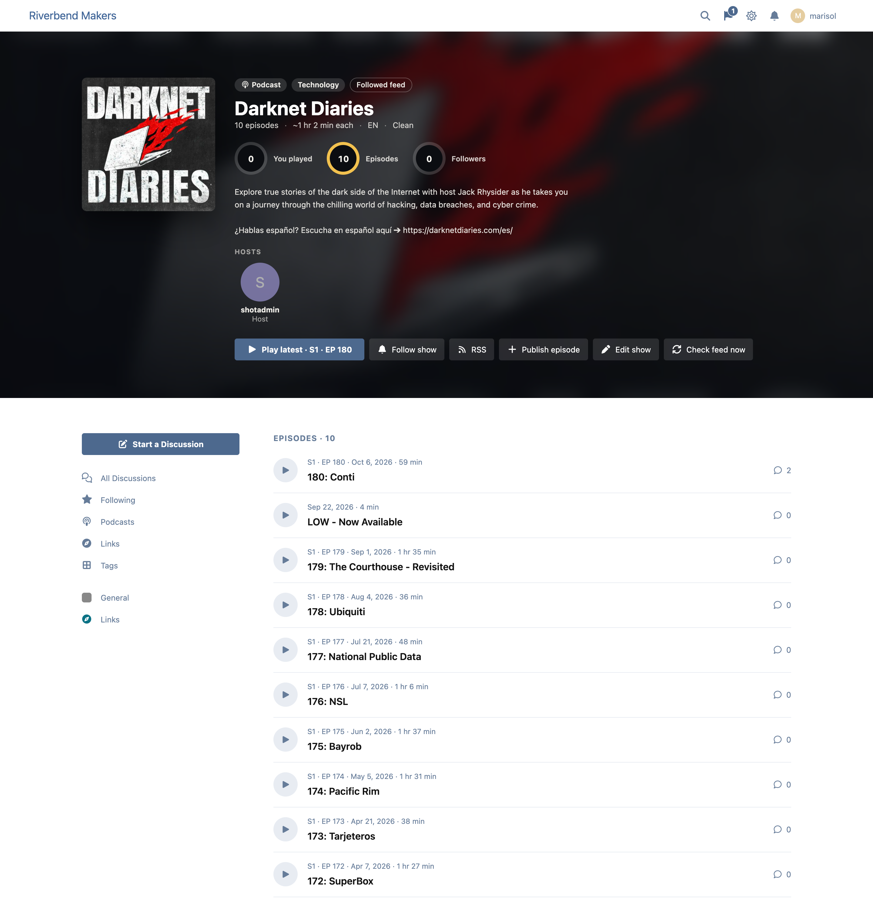
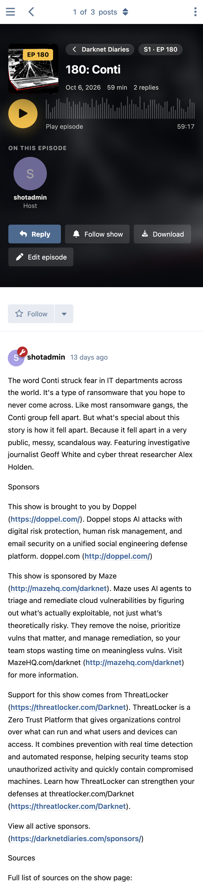

# Earshot

Podcasts that live in your forum. Every episode is a discussion, the player keeps going while members browse, and a show can be hosted on the forum or follow a feed hosted anywhere (Buzzsprout, Transistor, Spotify for Creators, Libsyn…).



## What it does

- **Every episode is a discussion.** Replies, mentions, subscriptions, search and permissions are Flarum's own. An episode in a members-only tag stays out of lists and out of the public feed.
- **A player that never stops.** It docks at the bottom of the window and keeps playing as members move around the forum: skip 15/30 seconds, playback speed, chapter marks, lock-screen and headset controls.
- **Everyone resumes where they stopped.** On the server for members (any device), in the browser for guests.
- **Timestamps become buttons.** "18:42" in a reply plays from 18:42. Times inside links, code, or past the end of the episode stay text. The composer can insert the player's current time.
- **Host here, or follow a feed.** Upload MP3/M4A/Ogg, or point a show at its RSS feed: new episodes arrive on their own, each with a discussion. A first follow brings in only the latest few episodes and tells nobody.
- **Chapters.** Podcasting 2.0 chapters from a feed, or typed as `12:30 The main story`.
- **A real podcast feed** for hosted shows (`/podcasts/your-show/feed`), with the `itunes:` and `podcast:` tags Apple Podcasts and Spotify expect.
- **Follow a show** and hear about each new episode (alert and email).
- **Subscribe buttons** for Apple Podcasts, Spotify, YouTube, Pocket Casts, Overcast and RSS.
- **A Latest episodes widget** for Bespoke and for fof/forum-widgets-core.
- **Light.** One small script on every page; the pages, player and styles load only where there is a podcast. No query added to any other page.







## Install

```sh
composer require ernestdefoe/earshot
php flarum migrate
php flarum cache:clear
```

Enable **Earshot** in the admin panel. Moderators can start shows (permission **Start and manage shows**); a show's hosts publish its episodes.

Followed feeds are read by Flarum's scheduler: make sure `php flarum schedule:run` runs every minute (see [Flarum's docs](https://docs.flarum.org/2.x/console#schedulerun)). `php flarum earshot:fetch --show=<slug>` reads one now.

Hosted audio is uploaded through PHP, so `upload_max_filesize`, `post_max_size` and your web server's body size limit (nginx `client_max_body_size`) must allow episode-sized files, or link to files hosted elsewhere.

## Settings

| Setting | Default | |
|---|---|---|
| Show "Podcasts" in the sidebar | on | |
| Read followed feeds every | 60 min | An unchanged feed costs one small conditional request. |
| Episodes to bring in when a feed is first followed | 10 | |
| Largest audio upload | 250 MB | Within PHP's and the web server's limits. |

## Earshot Pro

A paid add-on: supporter-only episodes with private feeds, scheduled and early releases, transcripts (read-along and searchable), clips, listener voicemail, guests and a studio with listening stats.

## Licence

MIT. If Earshot is useful to you, you can [buy me a coffee](https://buymeacoffee.com/ernestdefoe).
